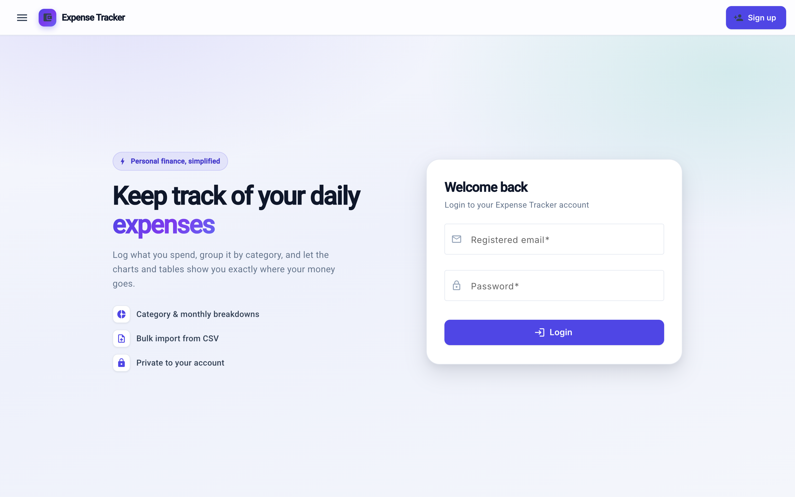
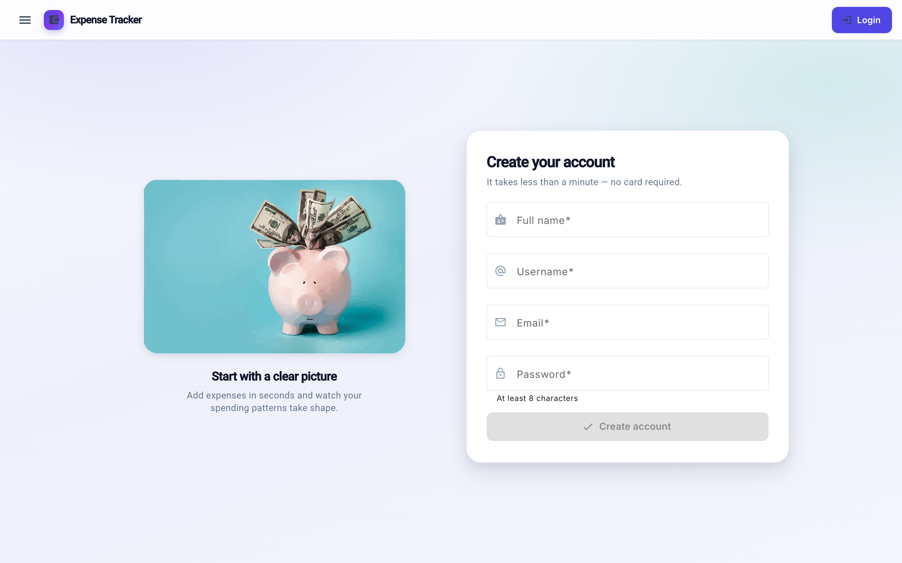
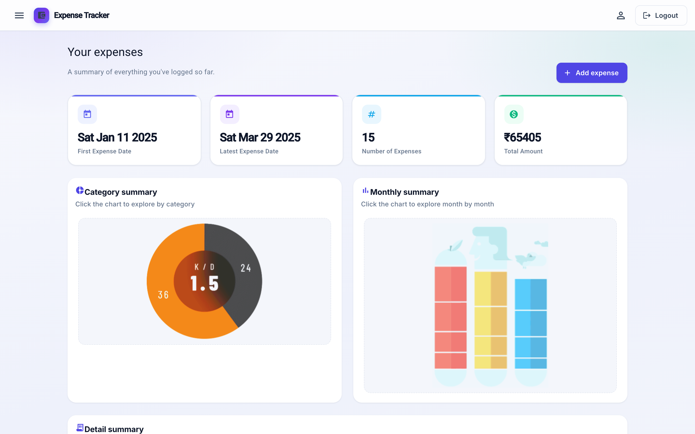
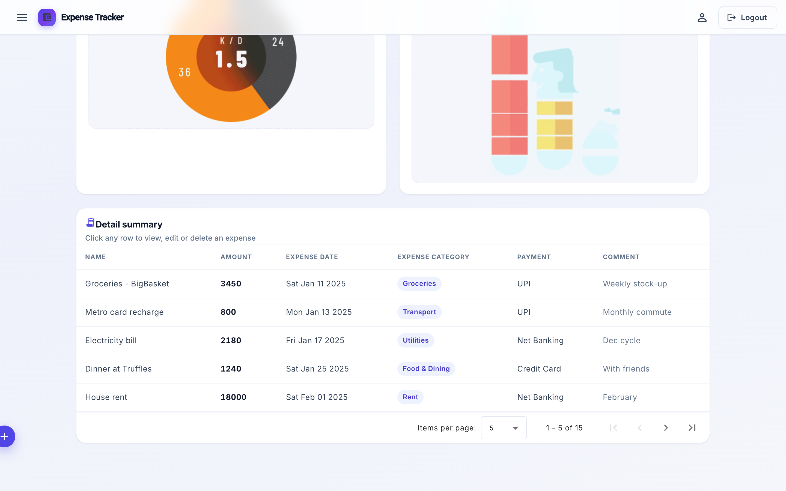
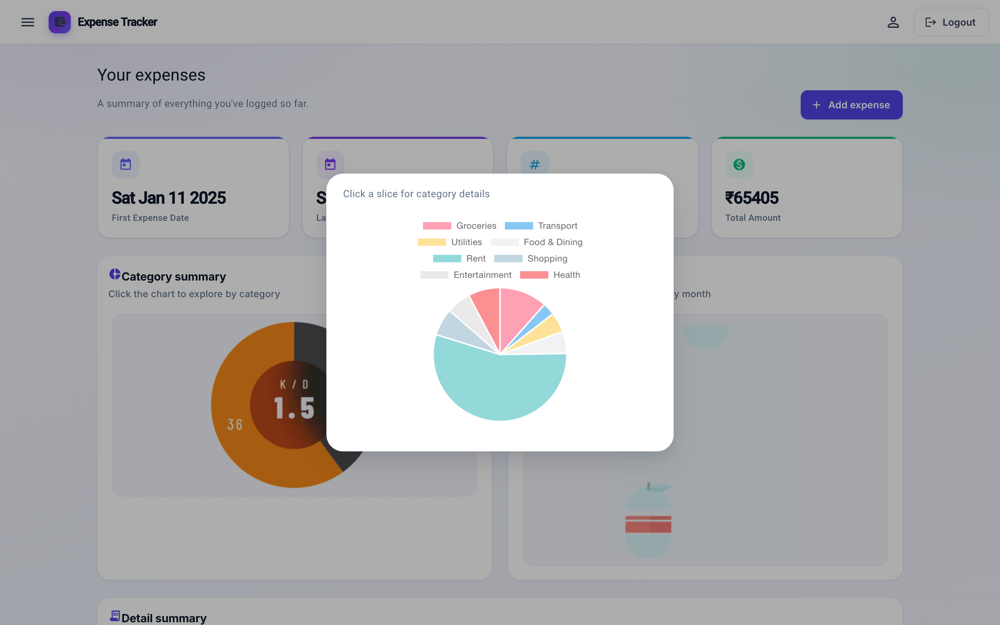
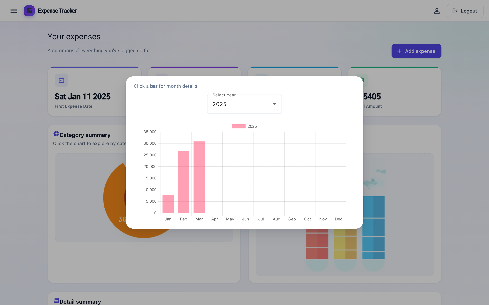
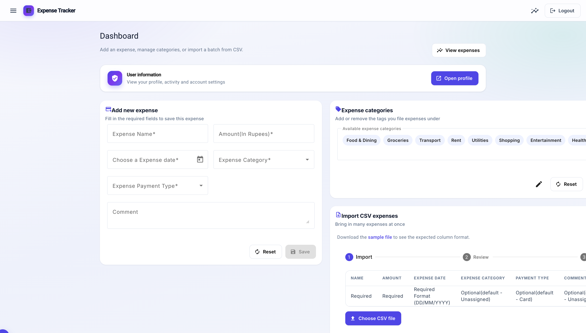
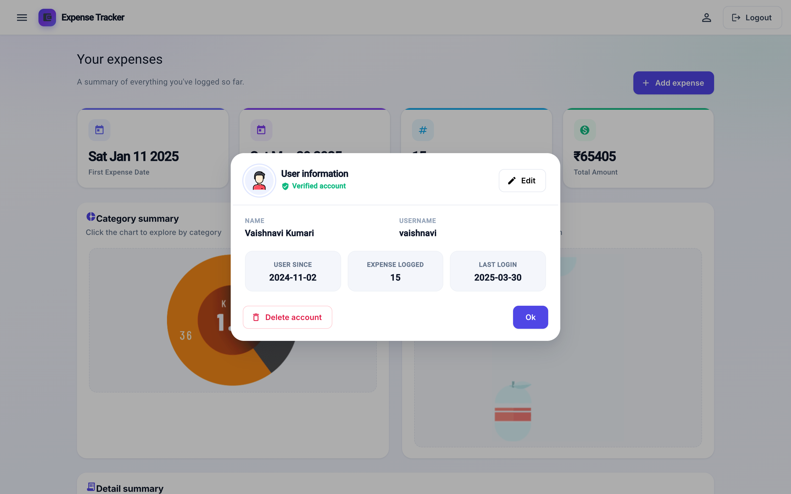

# 💸 Expense Tracker


A modern web application for tracking daily personal expenses. Users can log spends, organise them into custom categories, visualise where their money goes with **bar and pie charts**, and bulk-import historical data from **CSV** files — all behind a JWT-protected account.

---

## 📌 Table of Contents
- [Overview](#-overview)
- [Tech Stack](#️-tech-stack)
- [Features](#-features)
- [Project Structure](#-project-structure)
- [Installation](#-installation)
- [Usage](#-usage)
- [Environment Variables](#-environment-variables)
- [API Endpoints](#-api-endpoints)
- [Screenshots](#-screenshots)
- [Author](#-author)

---

## 🧩 Overview
Expense Tracker is a single-page Angular application that helps you understand your spending habits. After signing up, every expense you record is stored against your account with a name, amount, date, category, payment type and an optional comment. The dashboard then aggregates that data into sortable tables and interactive charts so you can see category-wise and month-wise breakdowns at a glance.

The app is a **frontend client** — it talks to a hosted REST API (Express + MongoDB) over HTTPS. Authentication uses JWT tokens attached to every request by an HTTP interceptor, with automatic logout when the token expires.

---

## 🛠️ Tech Stack
**Framework:** Angular 15 (modules + lazy-loaded feature routes)  
**Language:** TypeScript 4.9  
**UI:** Angular Material, Angular CDK, Bootstrap 5, SCSS  
**Charts:** Chart.js + ng2-charts  
**Forms:** Angular Reactive Forms  
**Auth:** JWT via `HttpInterceptor`, route protection with `AuthGuard`  
**Backend (hosted):** Node.js, Express, MongoDB (Mongoose), bcryptjs, jsonwebtoken

---

## ✅ Features
- 🔐 **Sign up / Login** with hashed passwords and JWT-based sessions
- ⏳ **Auto-logout** when the token expires, with session restored on refresh
- ➕ **Add, edit and delete expenses** — name, amount, date, category, payment type, comment
- 🏷️ **Custom categories** — create and edit your own instead of being stuck with defaults
- 📊 **Visual summaries** — bar and pie charts of spending by category
- 📋 **Dashboard & detail views** — browse all expenses or drill into a single entry
- 📥 **Bulk CSV import** — flexible header matching (`name` / `expense_name` / `expense name`, etc.) with a preview table before saving
- 👤 **Profile management** — view and update your name and username
- ⭐ **Feedback & rating** widget
- 📱 **Responsive layout** with Angular Material components and snackbar alerts

---

## 📂 Project Structure

```
src/
├── app/
│   ├── auth/                     # AuthService, AuthGuard, HTTP interceptor
│   ├── services/
│   │   └── business-data.service.ts   # Expense & category API calls
│   ├── component/
│   │   ├── welcome/              # Landing page → /welcome
│   │   │   ├── login/
│   │   │   └── signup/
│   │   ├── header/               # Authenticated shell → /home
│   │   │   ├── dashboard/
│   │   │   ├── add-expense/
│   │   │   ├── add-category/
│   │   │   └── import/           # CSV import
│   │   └── home/                 # Dashboard → /dashboard
│   │       ├── view-expenses/
│   │       ├── view-single/
│   │       └── show-chart/       # Bar & pie charts
│   ├── shared/                   # alert-box, loader, footer, profile, rating
│   └── app-routing.module.ts
├── environments/                 # API URL configuration
└── assets/
```

### Routes

| Route        | Description                       | Protected |
| ------------ | --------------------------------- | :-------: |
| `/welcome`   | Landing page with login & sign up |     ❌     |
| `/home`      | Add expense, add category, import |     ✅     |
| `/dashboard` | Expense list, details and charts  |     ✅     |
| `/edit/:id`  | Edit an existing expense          |     ✅     |
| `**`         | Redirects to `/welcome`           |     —     |

---

## 📦 Installation

```bash
# Clone the repository
git clone https://github.com/your-username/expense-tracker.git

# Navigate to the project folder
cd expense-tracker

# Install dependencies
npm install
```

> **Note:** Angular 15 is tested against Node.js 18. Newer odd-numbered Node releases will print an unsupported-version warning, though the build still runs.

---

## 🚀 Usage

```bash
# Start the development server
npm start
```

Then open **http://localhost:4200/**. The app reloads automatically when you change a source file.

```bash
# Create a production build (output in dist/)
npm run build

# Run unit tests with Karma
npm test
```

---

## 🔑 Environment Variables

This project uses Angular environment files rather than a `.env`. Update the API URL in `src/environments/`:

```ts
// src/environments/environment.ts
export const environment = {
  production: false,
  apiUrl: 'https://your-backend-url.com/v1/api/',
  adminId: 'your_admin_id',
  WEBSITE_URL: 'https://your-admin-site.com/'
};
```

| Variable      | Description                                        |
| ------------- | -------------------------------------------------- |
| `apiUrl`      | Base URL of the REST API the client calls          |
| `adminId`     | Admin user identifier used by the admin dashboard  |
| `WEBSITE_URL` | Link to the companion admin site                   |

Set the same values in `environment.prod.ts` for production builds.

---

## 🔌 API Endpoints

The client consumes the following endpoints, all prefixed with `apiUrl`:

**Authentication**
| Method | Endpoint                    | Purpose                |
| ------ | --------------------------- | ---------------------- |
| POST   | `USER/SIGN_UP`              | Register a new account |
| POST   | `USER/LOGIN`                | Log in, returns JWT    |
| DELETE | `USER/DELETE_ACCOUNT/:id`   | Delete the account     |
| POST   | `USER/USER_FEEDBACK/`       | Submit feedback        |

**Expenses & Categories**
| Method | Endpoint                          | Purpose               |
| ------ | --------------------------------- | --------------------- |
| GET    | `GET_ALL_EXPENSE/:id`             | List all expenses     |
| GET    | `GET_SINGLE_EXPENSE/:userId/:id`  | Fetch one expense     |
| POST   | `CREATE_EXPENSE`                  | Create an expense     |
| PATCH  | `UPDATE_EXPENSE/:userId/:id`      | Update an expense     |
| DELETE | `DELETE_EXPENSE/:userId/:id`      | Delete an expense     |
| GET    | `GET_CATEGORY/:userId`            | List categories       |
| POST   | `SAVE_CATEGORY/:userId`           | Create a category     |
| POST   | `EDIT_CATEGORY/:userId`           | Update a category     |
| POST   | `UPDATE_PROFILE/:userId`          | Update profile        |
| POST   | `UPDATE_NAME/:userId`             | Update display name   |

Every request carries the JWT in an `authentication` header, added automatically by `AuthInterceptor`.

---

## 📸 Screenshots

### Login


### Sign Up


### Dashboard


### Expense List


### Category Summary (Pie Chart)


### Monthly Summary (Bar Chart)


### Add Expense, Categories & CSV Import


### Profile


---

## 👤 Author

**Vaishnavi Kumari**

[](https://www.linkedin.com/in/vaishnavi-kumari-b6375b208/)
[](https://github.com/silversylvan83)

---

⭐ If you found this project useful, consider giving it a star!
